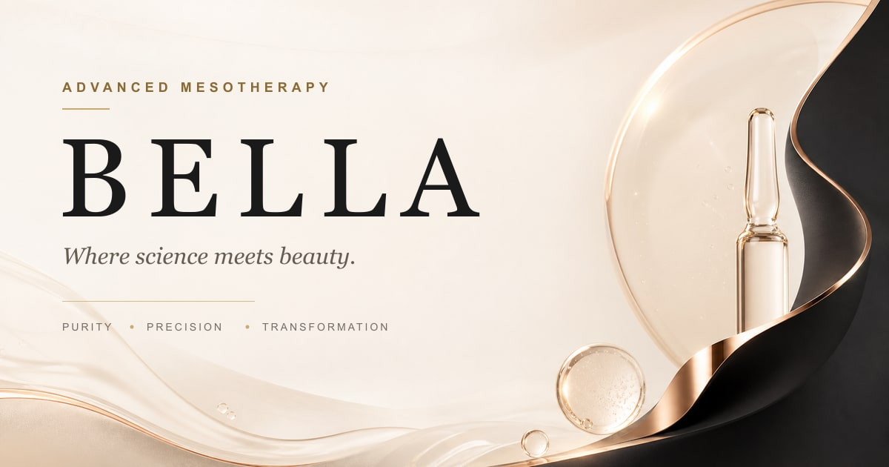

<div align="center">



# Bella Mesotherapy

**Advanced mesotherapy formulations crafted for transformative skin renewal.**  
Trusted by dermatologists across Egypt and the Gulf.

[](https://nextjs.org)
[](https://react.dev)
[](https://www.typescriptlang.org)
[](https://tailwindcss.com)
[](./LICENSE)

[Live Site](#) · [Products](/app/[locale]/products/) · [Contact](mailto:hello@bella-meso.com)

</div>

---

## Overview

**Bella** is a luxury mesotherapy brand from Egypt, offering 13 precision-formulated injectable vials for professional aesthetic practitioners. This repository contains the official marketing and e-commerce website — a bilingual (English & Arabic), SEO-optimised, performance-first web application.

The site showcases Bella's product catalogue, brand story, ingredients science, professional gallery, and contact experience — all delivered with a premium, animation-rich UI that reflects the brand's philosophy of *Purity · Precision · Transformation*.

---

## ✨ Key Features

- **Bilingual (EN / AR)** — Full right-to-left (RTL) support via `next-intl` with locale-aware routing
- **13 Mesotherapy Products** — Filterable catalogue with individual product detail pages
- **Rich Animations** — GSAP + Framer Motion powered micro-animations and page transitions
- **Smooth Scrolling** — Lenis scroll engine for a buttery, native-feel experience
- **Contact & Booking** — Formspree-powered contact and session-booking forms
- **SEO Optimised** — Dynamic Open Graph metadata, canonical URLs, structured headings
- **Accessible** — Skip-to-content, ARIA labels, keyboard-navigable throughout
- **Custom UI** — Custom cursor, scroll progress indicator, interactive lightbox gallery

---

## 🗂️ Project Structure

```
bella/
├── app/
│   ├── globals.css           # Global styles & CSS design tokens
│   ├── layout.tsx            # Root layout (fonts, meta)
│   └── [locale]/             # Locale-aware route group (en / ar)
│       ├── page.tsx          # Homepage
│       ├── about/            # Our Story page
│       ├── products/         # Products listing & [id] detail pages
│       ├── gallery/          # Visual gallery with lightbox
│       └── contact/          # Contact & inquiry page
├── components/
│   ├── layout/               # Navbar, Footer
│   ├── providers/            # Theme, Lenis smooth scroll, page transitions
│   ├── sections/             # Page section components (Hero, FAQ, CTA, …)
│   └── ui/                   # Reusable primitives (cursor, scroll progress, …)
├── data/                     # Static data (products, ingredients, testimonials, team)
├── i18n/                     # next-intl routing & request configuration
├── messages/
│   ├── en.json               # English copy
│   └── ar.json               # Arabic copy
├── lib/                      # Shared utilities and constants
├── public/                   # Static assets (images, OG image, favicon)
├── .env.example              # Environment variable template
├── next.config.ts            # Next.js + next-intl configuration
├── tailwind.config.ts        # Tailwind design tokens
└── tsconfig.json
```

---

## 🚀 Getting Started

### Prerequisites

| Tool | Version |
|------|---------|
| Node.js | ≥ 18.x |
| npm | ≥ 9.x |

### Installation

```bash
# 1. Clone the repository
git clone https://github.com/3tared/Bella-Mesotherapy.git
cd Bella-Mesotherapy

# 2. Install dependencies
npm install

# 3. Configure environment variables
cp .env.example .env.local
```

### Environment Variables

Open `.env.local` and fill in your values:

```env
# Formspree endpoint for the contact & booking forms
NEXT_PUBLIC_FORMSPREE_ENDPOINT=https://formspree.io/f/YOUR_FORM_ID
```

> Get a free endpoint at [formspree.io](https://formspree.io). Replace `YOUR_FORM_ID` with your actual form ID.

### Development

```bash
npm run dev
```

Open [http://localhost:3000](http://localhost:3000) — the app hot-reloads on file changes.

To test the Arabic locale, navigate to [http://localhost:3000/ar](http://localhost:3000/ar).

### Production Build

```bash
npm run build
npm run start
```

### Linting

```bash
npm run lint
```

---

## 🌐 Internationalization

The site supports **English** (default) and **Arabic** using [`next-intl`](https://next-intl-docs.vercel.app/).

| Locale | URL | Direction |
|--------|-----|-----------|
| English | `/` | LTR |
| Arabic | `/ar` | RTL |

All copy lives in `messages/en.json` and `messages/ar.json`. The routing is configured in `i18n/routing.ts` with `localePrefix: "as-needed"` — English uses the root URL and Arabic is prefixed with `/ar`.

To add a new locale:
1. Add the locale code to `routing.locales` in `i18n/routing.ts`
2. Create a `messages/<locale>.json` file mirroring the structure of `en.json`

---

## 🧩 Tech Stack

| Category | Technology |
|----------|-----------|
| Framework | [Next.js 16](https://nextjs.org) (App Router) |
| Language | [TypeScript 5](https://www.typescriptlang.org) |
| Styling | [Tailwind CSS v4](https://tailwindcss.com) |
| i18n | [next-intl v4](https://next-intl-docs.vercel.app) |
| Animations | [GSAP 3](https://gsap.com) + [Framer Motion 12](https://www.framer.com/motion/) |
| Smooth Scroll | [Lenis](https://lenis.darkroom.engineering) |
| Forms | [Formspree](https://formspree.io) |
| Lightbox | [Yet Another React Lightbox](https://yet-another-react-lightbox.com) |
| Utilities | [clsx](https://github.com/lukeed/clsx) + [tailwind-merge](https://github.com/dcastil/tailwind-merge) |

---

## 📄 Pages

| Route | Description |
|-------|-------------|
| `/` | Homepage — Hero, Manifesto, Products preview, Ingredients, How it works, Testimonials, FAQ, CTA |
| `/about` | Brand story, timeline, values, founder quote, team |
| `/products` | Filterable product catalogue (13 formulations) |
| `/products/[id]` | Individual product detail — benefits, ingredients, protocol, booking |
| `/gallery` | Visual gallery with category filters and full lightbox |
| `/contact` | Contact form, WhatsApp, email, and social links |

---

## 📦 Data

All product and content data is typed in `data/`. Key files:

- **`products.ts`** — Full product catalogue with benefits, ingredients, protocols, and how-to-use steps
- **`ingredients.ts`** — Active ingredients reference library
- **`testimonials.ts`** — Practitioner testimonials
- **`team.ts`** — Founding team members
- **`brand.ts`** — Brand-level constants
- **`clinical.ts`** — Clinical statistics and certifications
- **`gallery.ts`** — Gallery image manifest

---

## 🤝 Contact & Business Inquiries

| Channel | Details |
|---------|---------|
| 📧 Email | [hello@bella-meso.com](mailto:hello@bella-meso.com) |
| 📱 Phone / WhatsApp | +20 109 079 7965 |
| 📸 Instagram | [@bella_meso](https://instagram.com/bella_meso) |
| 🕐 Hours | Sunday – Thursday, 9am – 6pm (Cairo time) |

---

## 📜 License

This is a **private, proprietary project**. All rights reserved © 2024 Bella Mesotherapy, Egypt.  
Unauthorized copying, distribution, or use of this codebase is strictly prohibited.

---

<div align="center">

*Purity · Precision · Transformation*

**Made with ❤️ in Egypt**

</div>
